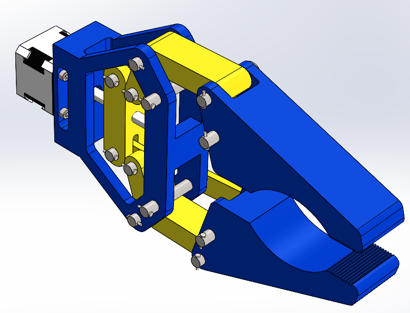
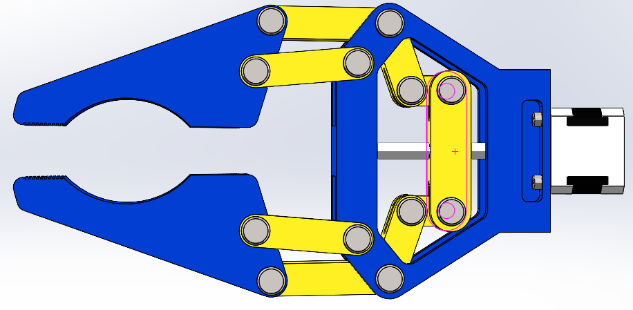
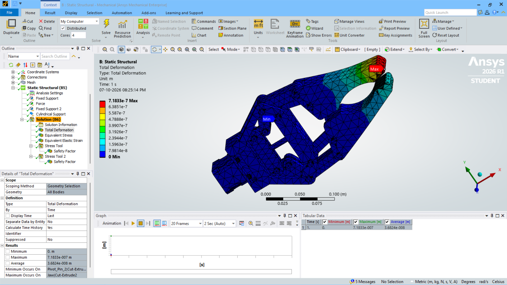
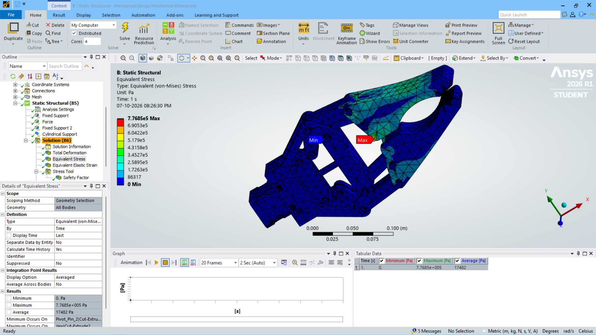
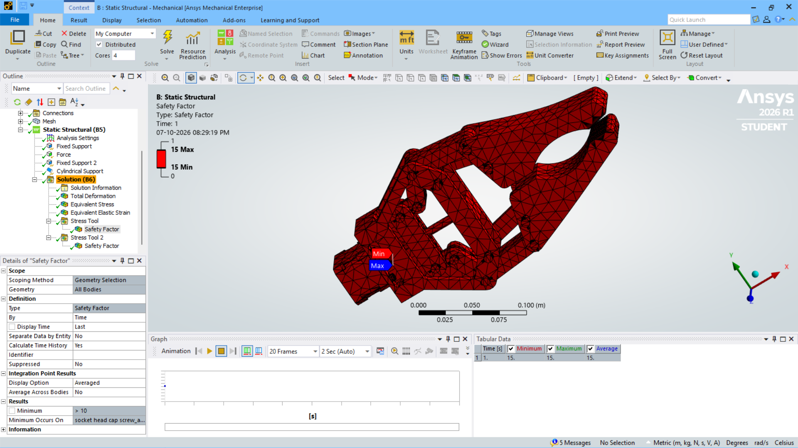

# Industrial 2-Finger Parallel Jaw Gripper
### CAD Design & Static Structural Analysis

A mechanical design and simulation project focused on developing a two-finger parallel jaw industrial gripper for robotic applications, with a target payload capacity of 5–10 kg.

## Project Overview

The objective of this project was to design a 2-finger parallel jaw gripper capable of securely holding objects through symmetric gripping motion.

The gripper assembly was modelled using SolidWorks, and its structural behaviour was evaluated through static structural analysis in ANSYS Workbench.

The project includes mechanical component modelling, assembly design, engineering load calculations, material assignment, and structural simulation.

## Design Objectives

- Design a two-finger parallel jaw gripper.
- Develop a complete 3D CAD assembly.
- Design for a maximum target payload of 10 kg.
- Calculate the required gripping force.
- Evaluate structural deformation and equivalent stress.
- Analyse equivalent elastic strain and safety factor.

## Software & Tools

| Software / Tool | Application |
|---|---|
| SolidWorks | 3D CAD modelling and assembly |
| ANSYS Workbench 2026 R1 Student | Static structural analysis |
| STEP | CAD model exchange format |

## CAD Design & Assembly

The gripper uses a parallel jaw mechanism to provide symmetric gripping motion.

The assembly includes:
- Motor mount bracket
- Two jaws
- Two jaw drivers
- Two rockers
- Two connecting links
- Slider
- Pivot pins
- Socket head cap screws
- Stepper motor representation

The design uses a blue and yellow component colour scheme.

### Assembly Views

*Complete 3D gripper assembly.*

*Side view of the parallel jaw gripper.*

## Material Selection

The project report specifies the following materials:

| Component | Material |
|---|---|
| Motor Mount Bracket | Aluminium Alloy 6061-T6 |
| Jaws | AISI 304 Steel |
| Jaw Drivers | Aluminium Alloy 6061-T6 |
| Rockers | Aluminium Alloy 6061-T6 |
| Connecting Links | Aluminium Alloy 6061-T6 |
| Slider | Aluminium Alloy 6061-T6 |
| Pivot Pins | Alloy Steel |
| Socket Head Cap Screws | Alloy Steel |

## Engineering Load Calculations

The gripping force was calculated for the maximum target payload of 10 kg.

### Design Parameters

| Parameter | Value |
|---|---:|
| Maximum payload mass | 10 kg |
| Gravitational acceleration | 9.81 m/s² |
| Coefficient of friction | 0.3 |
| Required baseline safety factor | 1.5 |
| Number of jaws | 2 |

### 1. Payload Weight

W = m × g

W = 10 × 9.81

**W = 98.1 N**

### 2. Total Required Normal Force

F_total = (W × S.F.) / μ

F_total = (98.1 × 1.5) / 0.3

**F_total = 490.5 N**

### 3. Force Per Jaw

F_jaw = F_total / 2

F_jaw = 490.5 / 2

**F_jaw = 245.25 N**

Therefore, the calculated required normal gripping force is **245.25 N per jaw**.

## ANSYS Static Structural Analysis

Static structural analysis was performed using ANSYS Workbench 2026 R1 Student.

The simulation setup included:
- Geometry preparation
- Mesh generation
- Fixed Support
- Fixed Support 2
- Cylindrical Support
- Applied Force
- Solution and result evaluation

### Simulation Results

| Analysis Parameter | Reported Result |
|---|---:|
| Maximum Total Deformation | 7.1833 × 10⁻⁷ m |
| Maximum Equivalent (von-Mises) Stress | 7.7685 × 10⁵ Pa |
| Maximum Equivalent Elastic Strain | 4.9633 × 10⁻⁶ m/m |
| Minimum Safety Factor | 15 |

### 1. Total Deformation

Maximum deformation reported: **7.1833 × 10⁻⁷ m**

### 2. Equivalent (von-Mises) Stress

Maximum equivalent stress reported: **7.7685 × 10⁵ Pa**

### 3. Equivalent Elastic Strain

Maximum equivalent elastic strain reported: **4.9633 × 10⁻⁶ m/m**

### 4. Safety Factor

Minimum safety factor reported: **15**

*All simulation values above are transcribed from the project report.*

## Project Files

The repository contains the following project resources:

| Folder | Contents |
|---|---|
| `CAD/` | Industrial gripper STEP assembly |
| `Simulation/` | ANSYS Workbench project archive |
| `Documentation/` | Detailed project report in PDF format |
| `Screenshots/` | CAD assembly and simulation result images |

## Conclusion

The project demonstrates the design and structural analysis of a two-finger parallel jaw industrial gripper.

The calculated gripping force required for the maximum target payload of 10 kg is 245.25 N per jaw, based on the assumptions documented in the report.

The ANSYS static structural analysis reports a maximum equivalent stress of 7.7685 × 10⁵ Pa, maximum deformation of 7.1833 × 10⁻⁷ m, and a minimum safety factor of 15.

These results indicate favourable structural performance under the simulated loading and boundary conditions. Further physical testing and validation would be needed before industrial deployment.

## Future Improvements

- Perform physical gripping and payload testing.
- Study dynamic loading conditions.
- Evaluate actuator torque and gripping speed.
- Investigate optimisation of component weight.
- Explore improvements in gripper actuation and control.

---

**Project Category:** Mechanical Design | Robotics | CAD | Structural Simulation

**Designed and documented by:** Swara Sukale

---

## Copyright & Usage Restrictions

**Copyright © 2026 Swara Sukale. All Rights Reserved.**

This project is publicly available for portfolio viewing, demonstration, and educational showcase purposes.

The original project materials created by the copyright owner, including CAD designs, 3D models, engineering calculations, documentation, simulation setup, and visual assets, are protected by applicable copyright laws.

No additional permission is granted to reproduce, modify, redistribute, or commercially use these original materials without prior written permission from the copyright owner, except for rights granted under GitHub's Terms of Service and applicable third-party licenses.

Third-party software, libraries, and components remain subject to their respective licenses.

For permission or collaboration inquiries, please contact the copyright owner.
